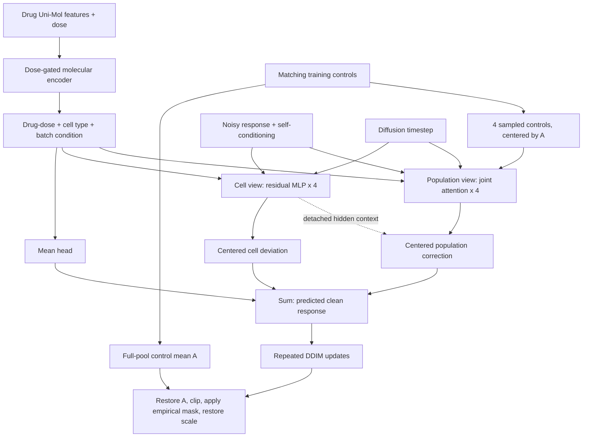

# Model architecture

[README](../README.md) · [한국어 설명](method_ko.md) · [Running experiments](usage.md)

**scDVD generates drug responses relative to a control anchor, combining a
condition-dependent mean with deviations from a cell view and a population view.**
Control and treated cells are unpaired; no before/after correspondence between
individual cells is required.

This guide describes the final **set4 scDVD**. The population-correction RMS cap
and population gate are removed. Dose gates and residual-block modulation gates remain.

## 1. Architecture at a glance

Training corrupts observed responses with noise and learns to recover them.
Generation starts from Gaussian noise and repeatedly applies the denoiser.
**Dual-view refers to the cell and population views**; the mean head is a
separate pathway for the condition-level response.

## 2. The output decomposition

In the model's normalized expression space, the prediction before clipping is

$$
\widehat{x}^{\mathrm{raw}}_i
= A + \mu_\theta(z)
+ \delta^{\mathrm{cell}}_i
+ \delta^{\mathrm{pop}}_i .
$$

| Term | Information used | Role |
|---|---|---|
| $A$ | All outer-training controls of the same cell type and batch | Reference expression state |
| $\mu_\theta(z)$ | Drug, dose, cell type and batch | Shared mean response |
| $\delta^{\mathrm{cell}}_i$ | Per-cell noisy response, self-conditioning, condition and timestep | Cell-level deviation |
| $\delta^{\mathrm{pop}}_i$ | Joint target/control attention and cell-view hidden context | Additional deviation informed by the populations |

Each deviation is centered **gene-wise over the four target slots**, so its
set mean is zero. The mean prediction over all four slots, before clipping and
masking, is therefore $A+\mu_\theta(z)$. Clipping, masking or discarding padded
outputs can change that mean.

This separates mean response from deviations structurally. The two deviation
terms are jointly learned and are not uniquely identified biological effects;
improvements in heterogeneity prediction require empirical evaluation.

## 3. Inputs and modules

A set contains **four targets sharing a treatment condition and four sampled
controls of the same cell type and batch**, each with 2,000 genes. Controls are
sampled with replacement, without one-to-one matching to targets. The anchor
uses the entire matching training-control pool, not those four sampled cells.

### Drug and dose encoder

A fixed 512-dimensional Uni-Mol feature vector passes through an MLP
`512 → 512 → 256` to obtain $e$. A second MLP receives $[e,d]$ and produces
a scalar dose gate:

$$
a=\operatorname{sigmoid}(f_{\mathrm{dose}}([e,d])),
\qquad p=a e .
$$

When $d=0$, $p$ is explicitly set to zero. Dose units are handled by the dataset
configuration; this encoder does not apply a log-dose transform. A projection
of $p$ to width 512 is added to cell-type and batch embeddings to obtain $z$.
The cell/population blocks additionally receive a timestep embedding. The mean
head does not receive the timestep or noisy target.

### Three output pathways

| Module | Computation | Output |
|---|---|---|
| Mean head | $z$ → LayerNorm → `512 → 512 → 2000` MLP | One response vector shared across the set |
| Cell view | `[noisy response, self-condition]` → `4000 → 512` projection → four conditional residual MLPs (`512 → 2048 → 512`) → gene head | `4 × 2000` deviations, centered over cells |
| Population view | Four projected target tokens + four centered-control tokens → four joint-attention blocks, eight heads | Population hidden concatenated with cell hidden → `1024 → 512 → 2000` correction head → centering |

The cell-view MLP acts independently on each cell; its final centering couples
the set. Population attention covers target–target, target–control and
control–control relationships. **Tokens are cells, not genes.** There is no
cell-order positional embedding; type embeddings distinguish target and control.

The population pathway branches from the target input projection rather than
starting after the cell-view blocks. Its correction head additionally reads
the cell-view hidden representation. The final linear layers of the mean and
correction heads are initialized to zero.

## 4. Training: response reconstruction and distribution matching

For treated expression $X$ and sampled controls $C$, define $R_0=X-A$ and
control context $C-A$. One timestep is drawn per set, with independent Gaussian
noise across cells and genes:

$$
R_t=\sqrt{\bar\alpha_t}R_0
+\sqrt{1-\bar\alpha_t}\,\epsilon,
\qquad \epsilon\sim\mathcal N(0,I).
$$

The denoiser **predicts the clean response $R_0$ directly**, rather than learning
an epsilon-prediction target. Adding $A$ reconstructs expression for the loss:

$$
\mathcal L
=\mathcal L_{\mathrm{positive\ MSE}}
+0.001\,\mathcal L_{\mathrm{GeomLoss\ energy}} .
$$

| Term | Supervision |
|---|---|
| Positive-expression MSE | Reconstruction error at positive GT entries; target-zero entries have zero direct MSE weight |
| GeomLoss energy | Distribution discrepancy between predicted and GT cell sets over all genes, before clipping or empirical masking |

Losses are calculated per set and averaged. **Both losses supervise the combined
prediction**, rather than assigning MSE exclusively to the cell view and energy
exclusively to the population view. Target-zero entries still enter the energy loss.

With probability 0.25 during training, a no-gradient preliminary response
prediction is supplied as self-conditioning. The perturbation condition is
replaced by a learned null embedding with probability 0.2 per set for
classifier-free guidance. Cell type, batch and control context remain available.

## 5. Generation and empirical sparsity masking

1. Prepare matching controls and the anchor; initialize the response with Gaussian noise.
2. Run **50-step DDIM**. At each step combine conditional and null-perturbation
   predictions as $\widehat R_u+1.5(\widehat R_c-\widehat R_u)$ and reuse that
   prediction as self-conditioning at the next step.
3. Restore the anchor and clip final expression to `[0,1]`.
4. Obtain a binary mask using a separately trained predictor and observed support
   patterns from training treated cells.
5. Multiply expression by the mask and restore the scale of the processed input H5AD.

The mask predictor receives **sampled control expression, control mean and
standard deviation, drug/dose, cell type and batch**. Three FiLM residual blocks
of width 512 predict gene-presence probabilities. It is trained separately with
BCE against `GT > 0` and has its own molecular condition encoder.

At evaluation, probabilities are averaged over the queried condition. The 300
genes with highest predicted probabilities define an L2 comparison against
training conditions' gene-presence frequency vectors. From the closest condition,
**whole observed binary cell masks are sampled with replacement**. Genes with
probability ≥0.99 are forced on; those with probability ≤0.01 are forced off.
This retains empirical joint support patterns instead of independently sampling
each gene. No test/OOD treated masks enter this library.

## 6. Final configuration

| Setting | Value |
|---|---|
| Genes / target set / sampled controls | 2,000 / 4 / 4 |
| Molecular embedding / denoiser width | 256 / 512 |
| Cell blocks / population blocks / attention heads | 4 / 4 / 8 |
| Forward diffusion / sampling | Linear β `1e-4 → 0.02`, 1,000 steps / DDIM 50 steps |
| Guidance / self-conditioning / condition dropout | 1.5 / 0.25 / 0.2 |
| Diffusion optimizer | AdamW, learning rate `1e-4`, cosine decay, weight decay 0 |
| Microbatch / accumulation | 8 sets / 4 microbatches |
| Stopping / checkpoint selection | Up to 100 epochs, patience 5 / minimum validation loss |
| Population RMS cap / population gate | None / removed |

<strong>Implementation details that affect interpretation and reproduction</strong>

- **Expression scale.** Prepared H5AD expression is divided by the outer-training
  maximum and clipped to `[0,1]`. The 2,000-HVG space is selected before benchmark
  splitting. Restoring the scale does not recover raw UMI counts.
- **Set4 partitioning.** `partition_set_size=16` preserves the reference internal
  train/validation cell membership before regrouping each pool into sets of four.
  Per-epoch training regrouping does not introduce validation cells.
- **Padding.** Repeated target cells fill short sets. They have zero direct loss
  weight but participate in attention and centering. Padded generated outputs
  are discarded.
- **Gradient routing.** Target projection, condition and cell hidden context
  are detached when read by the population pathway. Its blocks, control projection
  and correction head remain trainable. This does not separate the two losses
  into branch-specific objectives.
- **Energy convention.** The implementation uses
  `SamplesLoss(loss="energy", blur=0.05)`. `mmd_weight=0.001` is the historical
  config key for this coefficient, not for RBF MMD. The training discrepancy
  and the reported evaluation ED differ in estimator and scale.
- **Mask library.** Candidates come from outer-training treated cells, including
  internal validation cells, and are not restricted to the query's cell type.
  Final set4 runs reuse an already-trained mask checkpoint from the same parent split.
- **Gates.** Only the final population-correction gate is removed. Dose and block
  modulation gates remain. A zero perturbation embedding at dose zero does not
  force the complete predicted response to zero.
- **Inactive alternatives.** The KG/time encoder, control-inversion initialization,
  per-DDIM-step absolute clipping and historical capped/gated variants are not
  the final default path. Diffusion timestep is distinct from treatment duration.

## Implementation map

| Component | Source |
|---|---|
| Anchor and sets | [`data/unpaired.py`](../src/scdvd/data/unpaired.py), [`data/datamodule.py`](../src/scdvd/data/datamodule.py) |
| Drug/dose encoding | [`models/condition.py`](../src/scdvd/models/condition.py): `DoseGatedMolecularEncoder` |
| Mean, cell and population pathways | [`models/dual_view.py`](../src/scdvd/models/dual_view.py): `DualViewDenoiser` |
| Training, guidance and generation | [`module.py`](../src/scdvd/module.py), [`diffusion/gaussian.py`](../src/scdvd/diffusion/gaussian.py) |
| Losses | [`losses.py`](../src/scdvd/losses.py) |
| Mask prediction and retrieval | [`mask_module.py`](../src/scdvd/mask_module.py), [`models/mask_compat.py`](../src/scdvd/models/mask_compat.py), [`masking.py`](../src/scdvd/masking.py) |
| Final configuration and provenance | [`configs/model/scdvd.yaml`](../configs/model/scdvd.yaml), [`runs.json`](../benchmarks/manifests/runs.json) |
