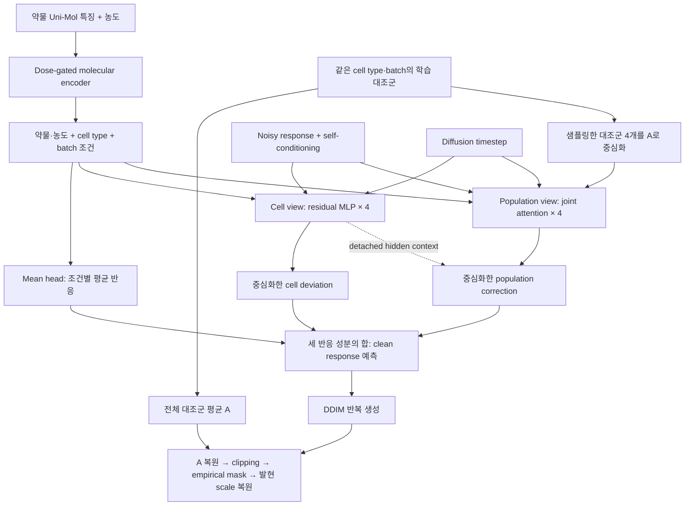

# scDVD 모델 구조

[README](../README.md) · [English](method.md) · [실행 방법](usage.md)

**scDVD는 대조군 평균을 기준으로 약물 반응을 생성하며, 조건별 평균 변화에
세포 관점과 집단 관점에서 예측한 편차를 더하는 조건부 diffusion 모델이다.**
대조군과 처리군은 서로 다른 세포 집단이므로, 처리 전후 동일 세포의 대응은 요구하지 않는다.

아래는 최종 **set4 scDVD** 기준이다. Population correction의 RMS cap과
population gate는 제거되어 있고, dose gate와 residual block 내부 gate는 유지된다.

## 1. 전체 구조

학습에서는 실제 처리 반응에 noise를 넣어 복원하도록 학습한다. 생성에서는
Gaussian noise에서 시작해 같은 denoiser를 반복 적용한다. 도식의 **dual-view는
cell view와 population view**를 뜻하며, mean head는 별도의 평균 반응 경로다.

## 2. 핵심 출력식과 각 성분의 역할

모델 내부의 정규화된 발현 공간에서, 세포 $i$의 clipping 이전 예측은 다음과 같다.

$$
\widehat{x}^{\mathrm{raw}}_i
= A + \mu_\theta(z)
+ \delta^{\mathrm{cell}}_i
+ \delta^{\mathrm{pop}}_i .
$$

| 성분 | 사용하는 정보 | 역할 |
|---|---|---|
| $A$ | 같은 cell type·batch의 학습 대조군 전체 | 반응을 표현할 기준 상태 |
| $\mu_\theta(z)$ | 약물·농도, cell type, batch | 조건에 공통적인 평균 변화 |
| $\delta^{\mathrm{cell}}_i$ | 세포별 noisy response, self-conditioning, 조건, timestep | 개별 세포의 반응 편차 |
| $\delta^{\mathrm{pop}}_i$ | target·control 집단의 joint attention과 cell-view hidden context | 집단 문맥을 반영한 세포별 추가 보정 |

두 편차는 **각 유전자에 대해 set 안의 평균을 빼서** 합이 0이 되도록 한다.
따라서 네 슬롯 전체의 clipping·masking 이전 평균은 $A+\mu_\theta(z)$다.
이렇게 평균 반응과 평균 주변의 이질성을 구조적으로 구분한다. Clipping, masking,
padding 슬롯 제거 후의 최종 평균까지 이 등식이 보장되는 것은 아니다.

두 편차는 함께 학습되는 성분이므로 각각을 고유한 생물학적 원인으로 해석하거나,
population view가 이질성을 개선했다고 구조만으로 단정할 수는 없다.

## 3. 입력과 모듈별 계산

한 set은 같은 처리 조건의 **target 4개 + 대응 cell type·batch의 control 4개**로
구성한다. 유전자는 2,000개이며, 두 집단 사이에 일대일 세포 matching은 없다.
Control은 복원추출하며, anchor $A$는 이 네 세포가 아니라 **전체 학습 대조군**에서 계산한다.

### 조건 인코더

고정된 512차원 Uni-Mol 특징을 MLP `512 → 512 → 256`에 통과시켜 $e$를 얻는다.
이 벡터와 농도 $d$를 연결한 MLP가 scalar dose gate를 계산한다.

$$
a=\operatorname{sigmoid}(f_{\mathrm{dose}}([e,d])),
\qquad p=a e .
$$

$d=0$이면 $p$를 정확히 0으로 만든다. 농도는 dataset 설정에서 단위를 맞춘 값을
사용하며, 이 encoder 안에서 log-dose 변환은 하지 않는다. $p$를 512차원으로
투영한 뒤 cell-type·batch embedding을 더한 값이 $z$다.
Cell/population block에는 여기에 timestep embedding을 더한 조건을 전달한다.
Mean head에는 timestep을 넣지 않는다.

### 세 출력 경로

| 모듈 | 계산 구조 | 출력 |
|---|---|---|
| Mean head | 조건 $z$ → LayerNorm → `512 → 512 → 2000` MLP | Set 전체가 공유하는 평균 반응 |
| Cell view | `[noisy response, self-condition]`을 `4000 → 512`로 투영 → conditional residual MLP 4개 (`512 → 2048 → 512`) → gene head | `4 × 2000` 편차를 유전자별 중심화 |
| Population view | 투영된 target 4개와 centered control 4개 → **8개 세포 토큰의 joint self-attention**, 8 heads, 4 blocks | Population hidden과 cell hidden을 연결 → `1024 → 512 → 2000` correction head → 중심화 |

Cell-view MLP는 세포별로 적용되며, 마지막 centering에서 set 정보가 연결된다.
Population view는 target–target, target–control, control–control 관계를 함께 처리한다.
Attention의 토큰은 유전자가 아니라 **세포**이며, cell-order positional embedding은 없다.
대신 target과 control을 구분하는 type embedding을 사용한다.

Population view는 cell-view 출력에서 직렬로 이어지는 경로가 아니다. 같은 target
입력 투영에서 분기하고, 마지막 correction head에서 cell hidden을 추가로 참조한다.
Mean head와 correction head의 마지막 linear layer는 0으로 초기화한다.

## 4. 학습: clean response 복원과 분포 정합

처리군 발현을 $X$, sampled control을 $C$라 하면, response는 $R_0=X-A$,
control context는 $C-A$다. 각 set에 하나의 timestep $t$를 샘플링하고, 세포·유전자별
Gaussian noise를 더한다.

$$
R_t=\sqrt{\bar\alpha_t}R_0
+\sqrt{1-\bar\alpha_t}\,\epsilon,
\qquad \epsilon\sim\mathcal N(0,I).
$$

Denoiser는 $R_t$에서 **clean response $R_0$를 직접 예측**한다. 학습 타깃을 noise
$\epsilon$로 두는 방식이 아니다. 예측 response에 $A$를 더한 발현에 두 손실을 적용한다.

$$
\mathcal L
=\mathcal L_{\mathrm{positive\ MSE}}
+0.001\,\mathcal L_{\mathrm{GeomLoss\ energy}} .
$$

| 항 | 감독하는 내용 |
|---|---|
| Positive-expression MSE | GT 발현이 양수인 유전자 위치의 재구성 오차. GT가 0인 위치의 직접 MSE 가중치는 0 |
| GeomLoss energy | 같은 set의 예측·GT 세포 분포 간 거리. 전체 유전자와 clipping·masking 이전 예측을 사용 |

손실은 set별로 계산한 뒤 평균한다. **두 손실 모두 세 성분을 합친 최종 예측에 적용**하며,
cell view에 MSE만, population view에 분포 손실만 따로 배정하는 구조가 아니다.
GT가 0인 위치도 분포 손실에는 포함된다.

학습 시 25% 확률로 gradient 없이 얻은 예비 response 예측을 self-conditioning 입력으로
넣는다. Perturbation 조건은 set별 20% 확률로 learned null embedding으로 바꾸어
classifier-free guidance를 준비한다. Cell type·batch·control context는 유지된다.

## 5. 생성과 empirical sparsity mask

1. 조건에 맞는 학습 control과 anchor를 준비하고, target response는 Gaussian noise로 초기화한다.
2. **50-step DDIM**으로 response를 생성한다. 각 step에서 conditional/null-perturbation
   예측을 $\widehat R_u+1.5(\widehat R_c-\widehat R_u)$로 결합하고, 이를 다음 step의
   self-conditioning에 사용한다.
3. 생성된 response에 anchor를 더하고 최종 발현을 `[0,1]`로 clipping한다.
4. 별도로 학습한 mask predictor와 학습 처리군의 실제 발현 여부 패턴으로 binary mask를 만든다.
5. 발현과 mask를 곱한 뒤 scale을 복원한다. 결과는 입력 H5AD의 전처리 발현 단위다.

Mask predictor는 **sampled control 발현 + control 평균·표준편차 + 약물·농도 +
cell type·batch**를 사용한다. Hidden width 512인 FiLM residual block 3개로
유전자별 발현 확률을 예측하며, `GT > 0`을 타깃으로 **별도의 BCE 학습**을 수행한다.
이 모델의 condition encoder도 diffusion 모델과 별도 파라미터다.

평가에서는 예측 확률을 생성 대상 조건 안에서 평균하고, 확률이 높은 300개 유전자로
학습 처리군 조건들의 발현 빈도 벡터와 L2 거리를 비교한다. 가장 가까운 조건 하나에서
**실제 세포의 binary mask 전체를 복원추출**한다. 확률 ≥0.99인 유전자는 1,
≤0.01인 유전자는 0으로 보정한다. 유전자마다 독립 Bernoulli sampling을 하는 방식과는
다르며, test/OOD 처리군의 mask를 참조하지 않는다.

## 6. 최종 설정 요약

| 항목 | 설정 |
|---|---|
| 유전자 / target set / sampled control | 2,000 / 4 / 4 |
| Molecular embedding / denoiser hidden | 256 / 512 |
| Cell blocks / population blocks / attention heads | 4 / 4 / 8 |
| Forward diffusion / 생성 | Linear β `1e-4 → 0.02`, 1,000 steps / DDIM 50 steps |
| Guidance / self-conditioning / condition dropout | 1.5 / 0.25 / 0.2 |
| Diffusion optimizer | AdamW, learning rate `1e-4`, cosine decay, weight decay 0 |
| Microbatch / gradient accumulation | 8 sets / 4 microbatches |
| 학습 종료 / checkpoint 선택 | 최대 100 epochs, patience 5 / 최소 validation loss |
| Population RMS cap / population gate | 없음 / 없음 |

<strong>구현을 정확히 설명할 때 필요한 세부사항</strong>

- **발현 스케일:** 전처리된 H5AD 발현을 outer train 전체의 최댓값으로 나누고
  `[0,1]`로 clipping한다. HVG 2,000개는 benchmark split 이전에 선택되어 있다.
  마지막 scale 복원은 raw UMI count 복원을 뜻하지 않는다.
- **Set4와 내부 partition:** 최종 모델은 set4지만, `partition_set_size=16`으로 기존
  train/validation 세포 소속을 먼저 재현하고 각각을 네 개씩 재구성한다.
  매 epoch의 train regrouping에 validation 세포는 들어가지 않는다.
- **Padding:** 부족한 target 슬롯은 중복 세포로 채운다. Padding의 직접 손실 가중치는
  0이지만, attention과 centering에는 네 슬롯 모두 참여한다. 생성 시 padding 출력은 제거한다.
- **Detach:** Population 경로가 참조하는 target projection, condition, cell hidden을
  detach한다. Population blocks, control projection, correction head는 계속 학습된다.
  이 설정이 두 손실을 서로 다른 branch로 분리하는 것은 아니다.
- **Energy의 의미:** `SamplesLoss(loss="energy", blur=0.05)`를 사용한다.
  설정 키 `mmd_weight=0.001`은 여기서 GeomLoss energy 계수이며 RBF MMD 계수가 아니다.
  이 학습 손실은 평가 표의 ED와 추정량·스케일이 같지 않다.
- **Mask 검색 범위:** Outer train 처리군을 사용하므로 내부 validation 세포도 포함된다.
  후보 조건은 queried cell type으로 별도 제한하지 않는다. 최종 set4 실험은 같은 parent
  split에서 이미 학습한 mask checkpoint를 재사용했다.
- **Gate 구분:** 제거한 것은 population correction의 최종 크기를 조절하던 gate다.
  Dose gate와 block 내부의 residual modulation gate는 남아 있다. Dose 0에서 embedding이
  0이어도 최종 반응 전체가 반드시 0으로 고정되는 것은 아니다.
- **현재 사용하지 않는 경로:** 소스의 KG/time encoder, control-inversion 초기화,
  매 DDIM step의 absolute clipping, 과거 capped/gated 설정은 현재 최종 모델의 기본 경로가 아니다.
  Diffusion timestep과 실제 약물 처리 시간은 구분해야 한다.

## 코드 위치

| 구성 | 실제 구현 |
|---|---|
| Anchor·set 구성 | [`data/unpaired.py`](../src/scdvd/data/unpaired.py), [`data/datamodule.py`](../src/scdvd/data/datamodule.py) |
| 약물·농도 조건 | [`models/condition.py`](../src/scdvd/models/condition.py): `DoseGatedMolecularEncoder` |
| Mean / cell / population 경로 | [`models/dual_view.py`](../src/scdvd/models/dual_view.py): `DualViewDenoiser` |
| 학습·guidance·생성 | [`module.py`](../src/scdvd/module.py), [`diffusion/gaussian.py`](../src/scdvd/diffusion/gaussian.py) |
| 손실 | [`losses.py`](../src/scdvd/losses.py) |
| Mask 학습·검색 | [`mask_module.py`](../src/scdvd/mask_module.py), [`models/mask_compat.py`](../src/scdvd/models/mask_compat.py), [`masking.py`](../src/scdvd/masking.py) |
| 최종 설정·실험 출처 | [`configs/model/scdvd.yaml`](../configs/model/scdvd.yaml), [`runs.json`](../benchmarks/manifests/runs.json) |
